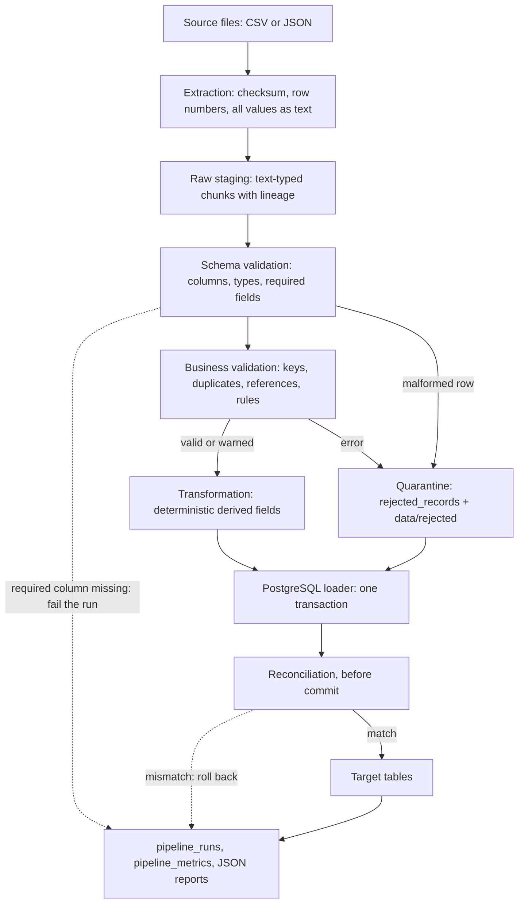

# DataFlow: Metadata-Driven Reusable ETL Framework

A reusable, configuration-driven Python framework that extracts, validates, transforms, and loads different
datasets into PostgreSQL, with data-quality controls, auditability, operational metrics, and idempotent
processing. It is demonstrated on two real public datasets with very different shapes.

## Evidence at a glance

| Check | Result | Evidence |
|---|---|---|
| Automated tests | 250 passed, 93% coverage | [test_results.txt](reports/test_results.txt) |
| Deliberately broken code | 21 of 21 bugs caught by the tests | [mutation_check.json](reports/mutation_check.json) |
| Real data against raw files, using none of the pipeline's validation, transformation, or loading code | 27 of 27 figures match | [independent_verification.json](reports/independent_verification.json) |
| Source-to-target totals | All match, difference 0.00 | [hotel](reports/reconciliation_hotel_bookings_source.json), [Olist](reports/reconciliation_olist_source.json) |
| Inside Docker | Pipeline ran and 250 tests passed | [docker_execution.txt](reports/docker_execution.txt) |
| Clean clone | Fresh install ran both samples, and 250 tests passed | Run by hand on Windows, not repeated on other systems |
| Sample outputs from synthetic data | Published rows, rejects, reconciliation | [reports/sample_output/](reports/sample_output/) |

## 1. Project overview

The same engine runs both datasets. Each is described by a YAML contract plus a small transformer module, and
nothing in the engine knows about either one.

| | Olist e-commerce | Hotel bookings |
|---|---|---|
| Shape | 9 related files, 1,550,922 rows | 1 flat file, 119,390 rows |
| Keys | Natural keys and enforced foreign keys | No key exists, so a derived ingestion ID |
| Exact duplicates | Collapsed, with a count kept | Loaded and flagged, as they may be real bookings |
| A changed file means | Incremental upsert | Snapshot of that file's rows |

## 2. Business problem

Teams often write a new one-off script for each data source, each with its own idea of validation, retries, and
logging. This framework separates what is common from what is specific: a new source needs a contract, not a new
pipeline.

## 3. Objectives

Correct data, and proof of it. Records that fail are traceable to their source line and never silently dropped.
Reruns are safe. Failures leave nothing half published. Every run leaves a measurable record.

## 4. Features

- **Extraction:** CSV and JSON, encoding detection, SHA-256 checksums, row numbers that stay correct when quoted
  fields contain newlines.
- **Validation:** schema drift, types, required fields, primary and foreign keys, business rules, with every failure on a
  record reported. Severity is per rule: `error` quarantines and `warning` loads with a flag.
- **Quarantine:** rejected records keep their original values as JSONB, with source file, row number, and reasons.
- **Transformation:** deterministic derived fields, with each rule documented.
- **Loading:** one transaction per run, `COPY` into a staging table, then an upsert that separates inserted, updated,
  unchanged, and out-of-date rows and archives what it replaces.
- **Idempotency and recovery:** per-file checksum tracking, safe retries, automatic recovery when a late parent arrives.
- **Reconciliation:** source totals taken from raw text are compared to the target before commit, and a difference
  rolls the load back.
- **Observability:** run history, per-rule metrics, JSON-lines logs, and a JSON report for every run.
- **Reproducible data:** a seeded generator with labelled defects, with answers kept apart from inputs.

## 5. Architecture



Details and entity-relationship diagrams: [docs/architecture.md](docs/architecture.md). Decisions and trade-offs:
[docs/design_decisions.md](docs/design_decisions.md).

## 6. Technology stack

Python 3.12, pandas, NumPy, Pydantic, SQLAlchemy 2, psycopg 3, PyYAML, python-dotenv, Faker, psutil, PostgreSQL 18,
pytest, pytest-cov, Docker Compose. Versions are pinned in `requirements.txt`.

## 7. Repository structure

```
config/settings.yaml        framework settings
config/datasets/*.yaml      one contract per dataset: columns, keys, rules, load strategy
src/core/                   settings, contract models, constants, exceptions
src/extractors/             CSV and JSON readers
src/validators/             schema, business, duplicate, and referential checks
src/transformers/           base class and one module per dataset
src/loaders/                PostgreSQL publishing
src/database/               connections, operational models, tables built from contracts
src/pipelines/              the engine and the runner
src/monitoring/             logging, metrics, run history
src/generators/             synthetic data
src/reporting/              reconciliation and benchmarks
scripts/                    profiling, verification, mutation check, and report tools
tests/                      unit, integration, edge_cases
data/samples/, data/expected/   synthetic samples and their answers, kept apart
reports/                    execution evidence
docs/                       architecture, data dictionary, sources, decisions, testing, AI usage
prompts/claude_prompts.md   complete AI prompt history
```

## 8-9. Data sources, licensing, and attribution

| Dataset | Kaggle identifier | Licence |
|---|---|---|
| Brazilian E-Commerce Public Dataset by Olist | `olistbr/brazilian-ecommerce` | CC BY-NC-SA 4.0 |
| Hotel Booking Demand (Antonio, Almeida & Nunes, 2019, via Jesse Mostipak) | `jessemostipak/hotel-booking-demand` | CC BY 4.0 |

Raw data is not committed and you download it yourself. Committed samples are fully synthetic. Olist is
non-commercial, which suits this assessment but would need review for commercial use. See
[docs/data_sources.md](docs/data_sources.md), which also lists what profiling found and the decision each finding led to.

## 10-12. Installation, configuration, and PostgreSQL

Requires Python 3.12, Docker with Compose, and at least 10 GB free on the drive holding Docker's data. That is mainly for
the benchmarks, whose repeated loads filled the disk on the machine this was built on, and stopped Docker.

```bash
python3.12 -m venv .venv            # Windows: py -3.12 -m venv .venv
source .venv/bin/activate           # Windows: .venv\Scripts\activate
pip install -r requirements.txt

cp .env.example .env                # then set POSTGRES_PASSWORD in .env
docker compose up -d db             # PostgreSQL 18 on 127.0.0.1:5434
```

| Setting | Where | Purpose |
|---|---|---|
| `POSTGRES_USER`, `POSTGRES_PASSWORD`, `POSTGRES_DB` | `.env` | Credentials, never committed |
| `POSTGRES_TEST_DB` | `.env` | Separate database used by tests |
| `POSTGRES_HOST`, `POSTGRES_PORT` | `.env` | `127.0.0.1` and `5434` by default |
| `DATAFLOW_BATCH_SIZE`, `DATAFLOW_LOG_LEVEL` | environment | Override `config/settings.yaml` |

Use `127.0.0.1`, not `localhost`: the port is published on IPv4 only, and `localhost` can stall trying IPv6 first.

## 13. Docker

```bash
docker compose up -d db                                 # database only; the pipeline is an on-demand job
docker compose --profile job build pipeline
docker compose run --rm pipeline --dataset hotel_bookings
docker compose run --rm --entrypoint pytest pipeline tests -q
```

`docker compose up -d` starts only the database, because a batch job should not launch by itself. The pipeline container
reaches the database at `db:5432`, and `data/`, `reports/`, `logs/`, and `config/` are mounted from the host.

**`CERTIFICATE_VERIFY_FAILED` during the build** means antivirus HTTPS scanning or a proxy is re-signing traffic with a root
certificate a clean container does not trust. Do not disable verification. Export that certificate as PEM, outside this
repository, and pass it as a build secret. It is used for the install step only and is not stored in the image:

```bash
docker build --secret id=extra_ca,src=/path/to/root_ca.pem -t dataflow-pipeline .
```

## 14. Downloading the data

```bash
curl -L -o olist.zip https://www.kaggle.com/api/v1/datasets/download/olistbr/brazilian-ecommerce
curl -L -o hotel.zip https://www.kaggle.com/api/v1/datasets/download/jessemostipak/hotel-booking-demand
unzip olist.zip -d data/raw/olist
unzip hotel.zip -d data/raw/hotel_bookings
```

Options using the Kaggle CLI or manual downloads are in [docs/data_sources.md](docs/data_sources.md). To try the framework
without downloading anything, use the committed samples below.

## 15. Running pipelines

```bash
python -m src.main --dataset olist
python -m src.main --dataset hotel_bookings
python -m src.main --dataset all

# Committed synthetic samples, with labelled defects:
python -m src.main --dataset hotel_bookings --source-dir data/samples/hotel_bookings/rows_100/dirty
python -m src.main --dataset olist --source-dir data/samples/olist/rows_100/dirty

# Generate data (rows for hotel, orders for Olist; seed 42 by default):
python -m src.main --generate --dataset olist --rows 1000
python -m src.main --generate --dataset hotel_bookings --rows 100000
```

Do not mix synthetic and real runs in one database. Point `POSTGRES_DB` at another database for experiments.

| Option | Effect |
|---|---|
| `--source-dir DIR` | Read source files from this directory |
| `--input FILE` | Process only this file, matched to its table by name. Repeatable |
| `--batch-size N` | Rows per batch |
| `--run-id UUID` | Use this run ID. A used ID is refused, so history cannot be overwritten |
| `--dry-run` | Do everything including reconciliation, then roll back |
| `--backfill` | Reprocess all files through the normal upsert. Unchanged rows stay untouched |
| `--full-refresh` | Drop target tables and rebuild. Run history is kept. Cannot be combined with `--input` |
| `--benchmark --sizes 1000,10000` | Measure performance on synthetic data, in a temporary database |

The exit code is 0 unless a run failed.

### Retry, restart, and backfill behavior

| Situation | What happens |
|---|---|
| Same file again | New run record, status `skipped`, nothing changes |
| Changed file | Reprocessed. Changed rows update and old values go to `record_history` |
| Earlier version restored | Treated as a change, because the skip check compares with the latest load |
| Contract changed | Files are reprocessed, because the skip key includes the contract hash |
| Connection lost | Retried with backoff up to `max_retries`. Safe because a failed attempt published nothing |
| Constraint or data error | Not retried. The run fails with the reason recorded, and nothing is published |
| Process killed | PostgreSQL rolls back. The next run marks the old one `abandoned` |
| Parent arrives after its child | The child waits in quarantine and loads automatically on a later run |
| Older version arrives after a newer one | Counted as `stale` and not applied, where a version column exists (`orders`) |
| Hotel file loses over half its rows | The run fails and nothing is deleted, as it looks truncated. `--full-refresh` if intended |

## 16. Tests

```bash
pytest -v
pytest --cov=src --cov-report=term-missing
python scripts/mutation_check.py     # confirm tests fail when the code is deliberately broken
python scripts/verify_real_data.py   # compare the database with the raw files
```

Strategy, the scenario-to-test map, and known untested scenarios: [docs/testing_strategy.md](docs/testing_strategy.md).

## 17-18. Database schema and data dictionary

| Schema | Tables |
|---|---|
| `olist` | `geolocation`, `product_category_translations`, `customers`, `sellers`, `products`, `orders`, `order_items`, `payments`, `reviews`, `order_summary` |
| `hotel` | `hotel_bookings` |
| `ops` | `pipeline_runs`, `pipeline_metrics`, `processed_files`, `rejected_records`, `record_history` |

The full dictionary, with every column's type, nullability, origin, and rules, is generated from the contracts:
[docs/data_dictionary.md](docs/data_dictionary.md).

**Naming conventions:** `snake_case` tables and columns. UUID `run_id`. Source column names kept exactly, including
misspellings such as `product_name_lenght`, so lineage stays exact. Deterministic SHA-256 for derived IDs. Run timestamps
are stored with a timezone and ISO-8601 in reports. Source timestamps stay timezone-naive because the sources state no
timezone, and none is invented. `source_file` and `source_row_number` appear on every loaded and rejected row.

**Hotel `record_id`** is derived from the file name and row position and is an ingestion ID, not a business key. The
source has no booking ID.

## 19. Example output

Results on the real datasets. More in [reports/sample_queries.md](reports/sample_queries.md), and the queries are in
[docs/sample_queries.sql](docs/sample_queries.sql).

```
hotel_bookings: success_with_rejects
  input=119390 valid=119209 rejected=181 inserted=119209 updated=0 unchanged=0 stale=0 deleted=0 failed=0

olist: success
  input=1550922 valid=1289091 rejected=0 inserted=1289091 updated=0 unchanged=0 stale=0 deleted=0 failed=0
```

| Hotel | Bookings | Canceled | Cancel % | Average ADR |
|---|---|---|---|---|
| City Hotel | 79,163 | 33,079 | 41.8 | 105.50 |
| Resort Hotel | 40,046 | 11,120 | 27.8 | 94.99 |

| Olist delivery | Reviews | Average score | Average delivery days |
|---|---|---|---|
| On time | 89,949 | 4.29 | 11.0 |
| Late | 6,410 | 2.27 | 33.8 |

## 20. Reconciliation

Full reports: [hotel](reports/reconciliation_hotel_bookings_source.json), [Olist](reports/reconciliation_olist_source.json).

| Table | Source rows | Loaded | Rejected | Collapsed | Why they differ |
|---|---|---|---|---|---|
| `hotel_bookings` | 119,390 | 119,209 | 181 | 0 | 180 zero-guest bookings, 1 negative ADR. 31,980 loaded rows are flagged exact copies |
| `geolocation` | 1,000,163 | 738,332 | 0 | 261,831 | Exact copies collapsed; `sum(duplicate_count)` = 1,000,163 |
| `customers` | 99,441 | 99,441 | 0 | 0 | |
| `orders` | 99,441 | 99,441 | 0 | 0 | |
| `order_items` | 112,650 | 112,650 | 0 | 0 | |
| `payments` | 103,886 | 103,886 | 0 | 0 | |
| `reviews` | 99,224 | 99,224 | 0 | 0 | |
| `products` | 32,951 | 32,951 | 0 | 0 | |
| `sellers` | 3,095 | 3,095 | 0 | 0 | |
| `product_category_translations` | 71 | 71 | 0 | 0 | |

| Total | Source | Target | Difference |
|---|---|---|---|
| Hotel ADR | 12,155,741.81 | 12,155,741.81 | 0.00 |
| Hotel cancellations | 44,199 | 44,199 | 0 |
| Hotel guests | 234,986 | 234,986 | 0 |
| Hotel nights | 408,433 | 408,433 | 0 |
| Olist item price | 13,591,643.70 | 13,591,643.70 | 0.00 |
| Olist freight | 2,251,909.54 | 2,251,909.54 | 0.00 |
| Olist item total | 15,843,553.24 | 15,843,553.24 | 0.00 |
| Olist payments | 16,008,872.12 | 16,008,872.12 | 0.00 |

Olist has no rejections because the real extract is relationally clean: all its foreign keys hold. Its anomalies are
loaded and flagged as warnings, such as 278 customer zips missing from geolocation and 23 orders delivered before reaching
the carrier. The rules that reject bad Olist data are shown working on the synthetic defects in `data/samples`.

Payments exceed item totals by 165,318.88 overall, and this is reported rather than hidden. Of that, 162,591.95 comes from
775 orders that have payments but no items. The remaining 2,726.93 is the net of small differences on orders with both,
of which `order_summary` flags 260 as differing by over 0.05. The source does not explain them, so they are not rejected.

As a separate check, [reports/independent_verification.json](reports/independent_verification.json) compares 27 figures
recomputed from the raw files, using none of the pipeline's validation, transformation, or loading code. All 27 match.

## 21. Performance

Measurements and method: [reports/performance_summary.md](reports/performance_summary.md). Each is a median of repeated
runs on synthetic data, because single runs on this machine varied more than the effects being measured.

| Dataset | Requested size | Records | Total | Extract | Validate | Transform | Load | Records/s | Peak memory |
|---|---|---|---|---|---|---|---|---|---|
| Hotel | 1,000 | 1,000 | 0.53s | | | | 0.09s | 1,885 | |
| Hotel | 10,000 | 10,000 | 1.96s | | | | 0.82s | 5,106 | |
| Hotel | 100,000 | 100,000 | 9.49s | | | | 5.44s | 10,539 | |
| Olist | 1,000 orders | 7,626 | 1.14s | 0.05s | 0.11s | 0.01s | 0.44s | 6,687 | 122 MB |
| Olist | 10,000 orders | 75,914 | 4.92s | 0.30s | 0.44s | 0.03s | 3.36s | 15,425 | 144 MB |
| Olist | 100,000 orders | 759,067 | 77.66s | 6.95s | 12.50s | 0.67s | 54.61s | 9,774 | 213 MB |

Every stage for every size is in the summary, including reruns. A rerun of unchanged files took 0.13s for hotel and 0.96s
for Olist, which is the time to checksum them. The real Olist files, 1,550,922 rows, loaded in 110s with a 275 MB peak.

**Bottleneck and optimizations.** Loading is the slowest stage. Two changes were measured:

| Optimization | Before | After | Improvement |
|---|---|---|---|
| Staging with `COPY` instead of row-at-a-time inserts, hotel load stage, 10,000 rows | 1.29s | 0.41s | 3.2x |
| The same, Olist load stage, 10,000 orders | 17.93s | 4.71s | 3.8x |
| Column null mask instead of `pd.isna` per value, hotel, 100,000 rows | 1.25s | 0.79s | 1.6x |
| The same, Olist geolocation, 100,000 rows | 0.34s | 0.27s | 1.25x |

**Next optimization, not done:** Python-side serialization and hashing still touch every value of every row. Writing
already-serialized text straight to `COPY`, and hashing with a vectorized method, is the next candidate. It was not
done because the current speed is adequate for this batch use and a change to hashing would invalidate stored hashes.

## 22. Known limitations

- **Whole-run transactions.** A failure in any file discards the whole run, which keeps retry simple but makes for a long
  transaction on the largest load, and a late failure wastes work.
- **In-memory duplicate tracking.** Keys and fingerprints seen in a file are held in memory, so very large files need
  more RAM. Peak memory was 275 MB on the 1.5 million row Olist load.
- **No schema migrations.** A contract change that alters columns needs `--full-refresh`, and an operational table change
  needs that schema archived and dropped.
- **Hotel IDs depend on position.** With no business key, inserting a row mid-file shifts later IDs. They report as updated,
  which is noisy but ends in the correct state.
- **Restoring an older file is partly blocked for `orders`.** Its version guard treats restored rows as stale, while tables
  without a version column revert, so `order_summary` can then mix versions. To truly roll back, use `--full-refresh` with
  the older files.
- **Unversioned tables are last-write-wins.** Only `orders` has a usable version column. For the others, the file loaded last
  wins, so files delivered in the wrong order can leave older values.
- **Deletes.** Upsert tables never delete, so a row dropped from a corrected Olist file stays and keeps its old attribution.
  Those runs report aggregates as `not_comparable`, which has no aggregate check beyond counts and SQL checks.
- **A short stray quote can pass.** A record spanning over 100 lines fails the file, but an unterminated quote swallowing
  fewer lines can look like a long field, because CSV allows newlines in quotes. The row count would come up short.
- **One machine.** No parallelism or orchestration. Benchmarks are relative figures from one shared laptop.
- **Quarantine retry scope.** Only rows whose sole failure is a missing parent recover automatically. Others stay open until a
  new version of their file arrives.
- **Timezones.** Source timestamps are stored as supplied, since neither source states a timezone.

## 23. Future enhancements

A scheduler for regular runs. Schema migrations with Alembic. Per-table commit options for very large loads. Parquet and
database sources. Data-quality thresholds that fail a run above a reject rate. A dashboard over `ops`.

## AI usage

Built with Claude Code. Prompt history: [prompts/claude_prompts.md](prompts/claude_prompts.md). What the AI did, what it got
wrong, and how results were checked: [docs/ai_usage.md](docs/ai_usage.md).
