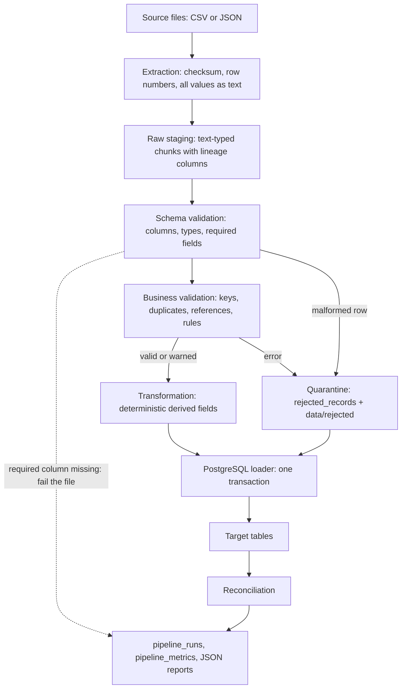
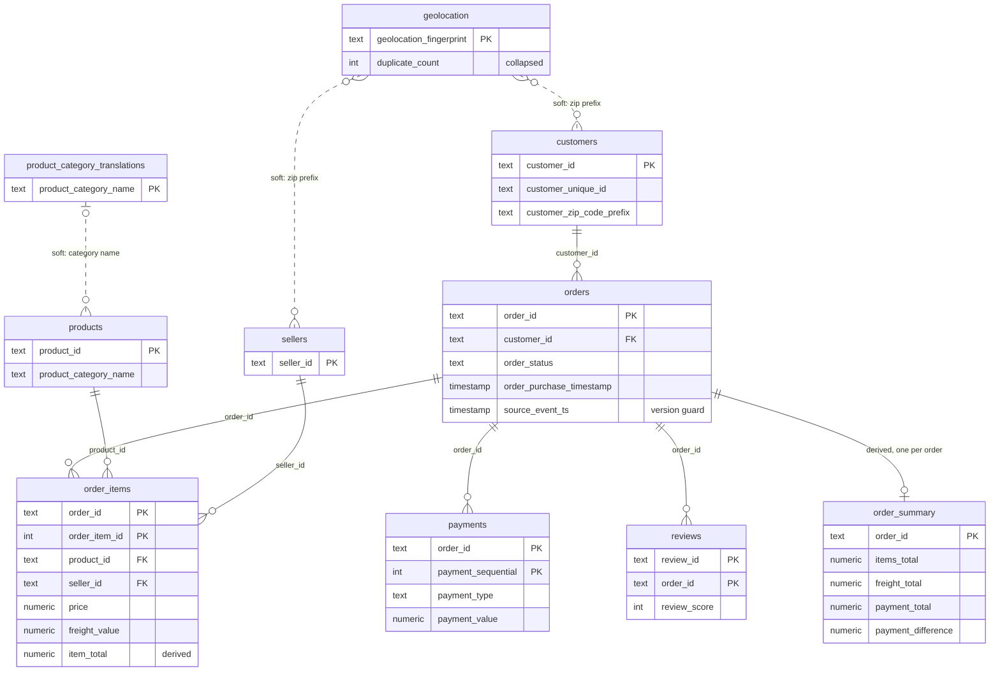
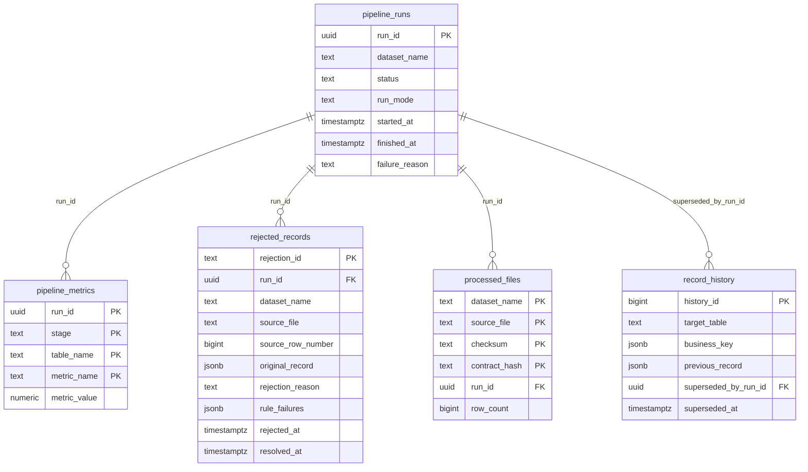

# Architecture

Status: the design below was finalized in Phase 1, before the real data was profiled.
Facts about the datasets marked *(to verify)* are expectations that Phase 2 confirms or
corrects against the actual files. Target columns are finalized from that profile.

## Pipeline flow

The same engine runs every dataset. A dataset is described by a YAML contract plus an
optional transformer module; nothing in the engine knows about Olist or hotels.

| Stage | Module | Reusable part | Dataset-specific part |
|---|---|---|---|
| Extraction | `src/extractors` | CSV and JSON readers, checksums, row numbering | File names in YAML |
| Validation | `src/validators` | Rule engine and check types | Rules in YAML |
| Transformation | `src/transformers` | Base class, row hash, IDs | `olist_transformer.py`, `hotel_transformer.py` |
| Load | `src/loaders` | Upsert, history capture, counts | Keys and strategy in YAML |
| Observability | `src/monitoring` | Logging, run records, metrics | None |
| Reconciliation | `src/reporting` | Report engine | Aggregates to compare in YAML |

## Execution workflow for one dataset

1. Create a `pipeline_runs` row (`running`) with a new UUID, committed immediately so the
   record survives any later failure.
2. Take a PostgreSQL advisory lock for the dataset. A concurrent run fails fast. Any older
   run still marked `running` must have died, so it is marked `abandoned`.
3. For each source file in foreign-key order, compute its checksum and look it up in
   `processed_files`. An unchanged file already loaded under the same contract is skipped.
4. Extract chunks, validate, and split into valid and rejected. References are checked
   against valid parents from this run plus parents already in the database, so a skipped
   parent file still satisfies its children.
5. Transform valid rows, then open **one transaction** covering target tables, history,
   quarantine rows, and `processed_files`. Any error rolls all of it back, so a file can
   never be recorded as processed when its data was not published.
6. Reconcile, write metrics and reports, and set the final run status in a separate
   transaction, so a failure reason is recorded even when the load rolled back.

## Entity relationships

Three PostgreSQL schemas keep datasets and operations apart. Every target table also carries
the audit columns: `source_file`, `source_row_number`, `first_run_id`, `last_run_id`,
`row_hash`, `created_at`, `updated_at`.

Solid lines are enforced foreign keys. Dotted lines are soft references, checked and reported
as warnings, because the source is expected to violate them legitimately *(to verify)*.

`hotel.hotel_bookings` stands alone. Its grain is one row per source row:

| Column | Role |
|---|---|
| `record_id` (PK) | SHA-256 of logical source name and row number. An ingestion ID, not a business key. |
| `record_fingerprint` | SHA-256 of the source column values, used to detect exact duplicates. |
| `is_exact_duplicate`, `duplicate_group_size` | Duplicate flag, not a rejection (see design decisions). |
| Source columns | As found in the file, typed. Finalized in Phase 2. |
| `total_nights`, `total_guests`, `arrival_date`, `estimated_booking_value` | Derived and documented. |

## Runtime topology

- **Local:** `docker compose up -d db`, then the pipeline in a virtualenv on the host,
  connecting to `127.0.0.1:5434`.
- **Docker:** the same database plus `docker compose run --rm pipeline ...`, connecting to
  `db:5432` on the Compose network. The pipeline is a job with a Compose profile, so
  `docker compose up -d` starts only the database and never launches a run by itself.
